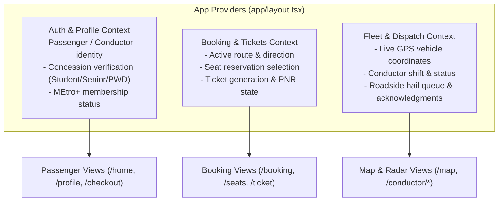

# Target Architecture & Responsive Strategy

**Project:** `track-me-tro`  
**Target Form Factors:** Mobile Phones (< 768px) and Tablets (768px – 1280px)  
**Architecture Pattern:** Domain-Driven Component Modularization & Layered Contexts  

---

## 1. Modular Directory Structure

```text
track-me-tro/
├── app/                                  # Next.js App Router route entry points
│   ├── layout.tsx                        # Global root layout & providers
│   ├── globals.css                       # Tailwind v4 theme & CSS variable tokens
│   ├── manifest.ts                       # Next.js MetadataRoute PWA manifest
│   ├── (auth)/                           # Authentication & Onboarding
│   │   ├── page.tsx                      # Landing / Login / Role Selector
│   │   └── signup/page.tsx               # Passenger registration & OTP
│   ├── (passenger)/                      # Passenger Routes
│   │   ├── home/page.tsx                 # Commuter dashboard
│   │   ├── map/page.tsx                  # Live tracking & roadside hailing
│   │   ├── schedule/page.tsx             # Timetable & filters
│   │   ├── booking/page.tsx              # Corridor route selector
│   │   ├── seats/page.tsx                # Interactive seat map
│   │   ├── checkout/page.tsx             # Payment & fare summary
│   │   ├── ticket/page.tsx               # Active digital boarding pass
│   │   └── profile/page.tsx              # Account, discount verification, perks
│   └── (conductor)/                      # Crew & Conductor Routes
│       ├── conductor/page.tsx            # Conductor command hub
│       ├── conductor/map/page.tsx        # Hail radar map
│       ├── conductor/matrix/page.tsx     # Cabin seat matrix & management
│       ├── conductor/scan/page.tsx       # QR code boarding validator
│       └── conductor/pos/page.tsx        # On-bus walk-in ticketing
├── components/
│   ├── ui/                               # Atomic shadcn/ui primitives (Radix UI)
│   │   ├── button.tsx
│   │   ├── card.tsx
│   │   ├── badge.tsx
│   │   ├── input.tsx
│   │   ├── dialog.tsx
│   │   ├── sheet.tsx
│   │   ├── tabs.tsx
│   │   └── separator.tsx
│   ├── shared/                           # Cross-domain layout & utility components
│   │   ├── AppShell.tsx                  # Responsive Phone + Tablet wrapper
│   │   ├── PageHeader.tsx                # Standardized navigation header with back button
│   │   ├── Logo.tsx                      # Brand asset
│   │   ├── CrownIcon.tsx                 # MEtro+ vector SVG icon
│   │   └── SplashScreen.tsx              # App launch loading screen
│   ├── passenger/                        # Passenger-specific domain components
│   │   ├── BottomNavigation.tsx          # 5-tab commuter bottom dock
│   │   ├── QuickBookCard.tsx             # Home screen origin/dest booking card
│   │   ├── LiveBusCard.tsx               # Home screen nearest bus ETA card
│   │   ├── BoardingAlertSheet.tsx        # Proximity threshold alert drawer
│   │   ├── MetroPlusModal.tsx            # MEtro+ perk upgrade dialog
│   │   └── DiscountVerifyModal.tsx       # Student/Senior/PWD concession modal
│   └── conductor/                        # Conductor-specific domain components
│       ├── SwipeableHailCard.tsx         # Gesture-driven passenger hail card
│       ├── ShiftSetupModal.tsx           # Driver shift initialization dialog
│       ├── BusStatusToggle.tsx           # In Queue / Boarding / Departed switcher
│       ├── PassengerCounter.tsx          # Onboard passenger load incrementer
│       └── WalkInTicketModal.tsx         # Seat assignment & cash fare popover
├── lib/
│   ├── utils.ts                          # shadcn `cn` utility (clsx + tailwind-merge)
│   ├── AppContext.tsx                    # Central state manager (to be subdivided into domain contexts)
│   ├── hooks/                            # Custom domain hooks
│   │   ├── useCorridorRoute.ts           # Direction, origin, destination formulas
│   │   ├── useBusTracking.ts             # Active bus coordinates & ETA calculation
│   │   ├── useFareCalculator.ts          # Base fare & 20% concession discounts
│   │   └── useHailsSync.ts               # LocalStorage & multi-tab passenger hails
│   └── data/                             # Pure static data & geometry models
│       ├── corridorData.ts               # Stops, GPS waypoints, fare rules
│       ├── scheduleData.ts               # Departures, intervals, roster
│       ├── fleetData.ts                  # Bus vehicles & dispatch states
│       └── conductorData.ts              # Seat layouts & POS stops
└── docs/                                 # Centralized project documentation
```

---

## 2. Phone + Tablet Responsive Strategy

### The Form Factor Dilemma
- On **mobile phones** (< 768px), transit riders and conductors require a tight, single-column viewport with bottom-docked navigation (`pb-safe`) for one-handed operation.
- On **tablets** (iPad, Android tablets, 768px–1280px), full-width stretching leads to excessive whitespace, unwieldy button widths, and diluted visual hierarchy.

### Two Responsive Layout Variants (`AppShell.tsx`)

#### Variant A: `passenger` (Centered Focus Container)
- **Phone (`< 768px`):** Full viewport width with standard 16px/20px horizontal padding. Fixed bottom navigation bar.
- **Tablet (`md:` 768px–1024px, `lg:` > 1024px):**
  - Container width constrained to `max-w-2xl` or `max-w-3xl` centered on screen (`mx-auto`).
  - Cards and data sections switch from vertical stacks to 2-column grids (e.g. Origin/Destination selector beside Quick Booking summary).
  - Floating bottom navigation aligns with the centered container rather than stretching across the entire tablet width.

#### Variant B: `conductor` (Dual-Column Command Hub)
- **Phone (`< 768px`):** Single-column stacked stream: Shift status ➔ Passenger count counter ➔ Live hails queue ➔ Action buttons.
- **Tablet (`md:` & `lg:`):**
  - Expands to a spacious `max-w-6xl mx-auto` dashboard.
  - **Left Column (40% width):** Operational controls (Bus status toggle, passenger load gauge, quick actions, shift info).
  - **Right Column (60% width):** Live data feeds (Incoming hail queue, active radar map preview, seat matrix glance).
  - Enables conductors on vehicle-mounted tablets to monitor passengers and seat availability simultaneously without switching tabs.

---

## 3. State Management Boundaries

To decouple the 909-line `AppContext.tsx`, state is partitioned into three logical boundaries:



1. **Auth & Concession Layer:** Manages passenger/conductor session, concession ID/agency verification, and MEtro+ tier status.
2. **Booking & Ticketing Layer:** Manages trip selection, seat locking, payment method, and generated PNR ticket models.
3. **Fleet & Dispatch Layer:** Manages real-time vehicle positions, proximity alerts, roadside passenger hails, and conductor passenger load counter.
