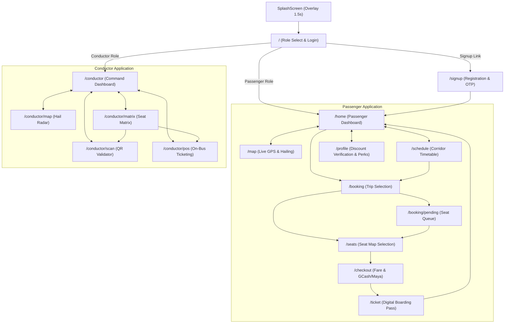
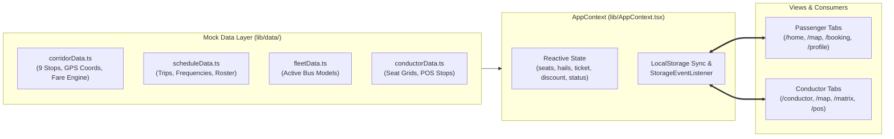
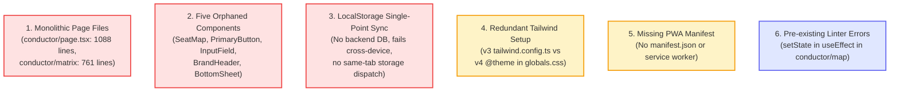

# Technical Architecture & Codebase Audit: track MEtro

**Project:** `track-me-tro` (Dual-App Transit Ecosystem for Leyte Corridor)  
**Framework:** Next.js 16.4.6 (App Router), React 19.3.0, TypeScript 5.9.3, Tailwind CSS v4  
**Date of Audit:** November 22, 2026  

---

## 1. Directory & File Structure

```text
track-me-tro/
├── app/
│   ├── favicon.ico
│   ├── globals.css                       # Tailwind v4 @theme tokens, typography, safe-area, animations
│   ├── icon.png                          # App icon (PWA / favicon)
│   ├── layout.tsx                        # Root layout: font injection, AppProvider & SplashScreen wrapper
│   ├── page.tsx                          # Role selection landing / Passenger login / MEtro+ preview modal
│   ├── booking/
│   │   ├── page.tsx                      # Trip booking & route corridor selection
│   │   └── pending/
│   │       └── page.tsx                  # Seat reservation pending & ticket generation wait screen
│   ├── checkout/
│   │   └── page.tsx                      # Fare breakdown & payment gateway simulation (GCash / Maya)
│   ├── conductor/
│   │   ├── page.tsx                      # Conductor command center (shift, dispatch, hails, load counter)
│   │   ├── map/
│   │   │   └── page.tsx                  # Conductor hail radar (Leaflet map with passenger pins)
│   │   ├── matrix/
│   │   │   └── page.tsx                  # Live cabin seat matrix, walk-in ticketing & no-show control
│   │   ├── pos/
│   │   │   └── page.tsx                  # On-bus Point-of-Sale (POS) ticket issuance for walk-in riders
│   │   └── scan/
│   │       └── page.tsx                  # Camera QR scanner / PNR validation for passenger boarding
│   ├── home/
│   │   └── page.tsx                      # Passenger home dashboard (quick book, live tracking card, MEtro+)
│   ├── map/
│   │   └── page.tsx                      # Fullscreen interactive Leaflet passenger tracking & hailing
│   ├── profile/
│   │   └── page.tsx                      # User profile, discount ID verification, perks, demo controls
│   ├── schedule/
│   │   └── page.tsx                      # Corridor daily timetable & direction filters
│   ├── seats/
│   │   └── page.tsx                      # Passenger seat selection map (40-seat coach layout)
│   ├── signup/
│   │   └── page.tsx                      # Passenger registration & phone OTP verification
│   └── ticket/
│       └── page.tsx                      # Digital boarding pass with QR code & live countdown
├── components/
│   ├── BoardingAlertSheet.tsx            # Bottom sheet for setting proximity alert thresholds
│   ├── BottomNavigation.tsx              # Passenger 5-tab sticky bottom navigation bar
│   ├── BottomSheet.tsx                   # Generic modal bottom sheet container [UNUSED]
│   ├── BrandHeader.tsx                   # Kinetic transit branding header graphic [UNUSED]
│   ├── ConductorMapLeaflet.tsx           # Leaflet map instance for conductor hail radar
│   ├── CrownIcon.tsx                     # Vector SVG icon for MEtro+ premium branding
│   ├── InputField.tsx                    # Controlled input component with validation styling [UNUSED]
│   ├── LiveMapLeaflet.tsx                # Leaflet map instance for passenger live vehicle tracking
│   ├── Logo.tsx                          # Responsive branded logo image component
│   ├── MetroPlusModal.tsx                # MEtro+ feature upsell & subscription modal
│   ├── PrimaryButton.tsx                 # Standardized pill action button [UNUSED]
│   ├── ScheduleList.tsx                  # Timetable list with live countdown & filter chips
│   ├── SeatMap.tsx                       # Standalone 40-seat interactive grid [UNUSED]
│   ├── SplashScreen.tsx                  # App launch loading screen (1.5s beating logo)
│   └── SwipeableHailCard.tsx             # Touch-draggable passenger hail card for conductor
├── lib/
│   ├── AppContext.tsx                    # Central React Context state, actions & localStorage sync
│   ├── mockData.ts                       # Barrel export for modular data files
│   ├── leyteHighwayCoords.json           # GPS coordinates for Route 70 Leyte Coastal Highway polyline
│   ├── routeCoords.json                  # Auxiliary route polyline coordinates
│   └── data/
│       ├── conductorData.ts              # Conductor profile, seat structures, POS stops
│       ├── corridorData.ts               # 9 Corridor stops, GPS coords, fare engine, active buses
│       ├── fleetData.ts                  # Fleet simulation helpers (active & departed buses)
│       ├── index.ts                      # Data barrel re-exporter
│       └── scheduleData.ts               # Timetable generator, interval formulas, driver roster
├── public/
│   ├── favicon.ico
│   ├── icon.png
│   ├── leaflet.css                       # Standalone Leaflet stylesheet for zero-dependency map styling
│   ├── logo-transparent.png              # Primary transparent logo
│   ├── logo-cropped.jpg / logo.png       # Alternate logo variations
│   └── images/                           # Leaflet marker icons & shadows
├── eslint.config.mjs
├── next.config.ts                        # Next.js configuration
├── package.json                          # Dependencies & build scripts
├── postcss.config.mjs                    # PostCSS Tailwind plugin loader
├── tailwind.config.ts                    # Extended theme tokens & fonts
└── tsconfig.json                         # TypeScript configuration
```

---

## 2. Routes & Screen Flows



### Route Breakdown

| Route | File Path | Key Features & Interactions | Incoming Navigation | Outgoing Navigation |
| :--- | :--- | :--- | :--- | :--- |
| **Splash Screen** | `components/SplashScreen.tsx` | Centered beating logo displayed for 1.5s on app launch/refresh, fading out smoothly over 300ms. | All entry points | Reveals underlying page |
| **Landing / Login** | `app/page.tsx` | Role toggle (Passenger vs Conductor), mobile phone input, 1-click demo logins, "Why Use MEtro+?" modal. | Direct visit / Log out | `/home`, `/conductor`, `/signup` |
| **Signup** | `app/signup/page.tsx` | 2-step onboarding: Mobile phone & details submission ➔ 6-digit OTP verification simulation. | `/` ("Sign Up") | `/home`, `/` |
| **Passenger Home** | `app/home/page.tsx` | Quick Book card with direction switcher, nearest active bus live card, corridor route strip, MEtro+ promo banner, upcoming departures. | `/`, `/ticket`, bottom nav | `/map`, `/booking`, `/seats`, `/schedule`, `/profile` |
| **Live Map** | `app/map/page.tsx` | Interactive Leaflet tracking along Route 70, bus inspection drawer, Boarding Alert proximity modal, digital bus hail button. | Bottom nav, `/home` | `/booking`, `/seats`, bottom nav |
| **Schedule** | `app/schedule/page.tsx` | Timetable with Sogod ⇄ Ormoc directional tabs, filter chips (All Active, Aircon, Non-Aircon, Arrived), direct "Book Now" triggers. | Bottom nav, `/home` | `/booking`, bottom nav |
| **Trip Booking** | `app/booking/page.tsx` | Corridor stop selector with swap button, available trip time picker, passenger discount indicator, direct proceed to seat selection. | `/home`, `/map`, `/schedule` | `/seats`, `/booking/pending`, `/home` |
| **Pending Booking** | `app/booking/pending/page.tsx` | Simulated automated seat assignment queue for non-reserved bookings. | `/booking` | `/seats`, `/home` |
| **Seat Selection** | `app/seats/page.tsx` | Visual 40-seat bus cabin layout (2x2 seating + 5-seat rear bench), occupied/reserved/selected states, live fare summary. | `/booking`, `/home` | `/checkout`, `/booking` |
| **Checkout** | `app/checkout/page.tsx` | Fare itemization (Base Fare + ₱15 Convenience Fee − Concession Discount), payment method selector (GCash / Maya), booking confirmation. | `/seats` | `/ticket`, `/seats` |
| **Digital Ticket** | `app/ticket/page.tsx` | Active boarding pass with generated PNR barcode/QR, travel itinerary, live departure countdown, trip cancellation modal. | `/checkout`, bottom nav | `/home`, bottom nav |
| **Passenger Profile** | `app/profile/page.tsx` | Account details, discount verification modal (Student/Senior/PWD concession with ID number & agency), MEtro+ management, simulation controls (time, location, tier). | Bottom nav | `/`, bottom nav |
| **Conductor Command** | `app/conductor/page.tsx` | Shift setup modal, bus dispatch status (In Queue / Boarding / Departed), passenger load counter, live incoming hail queue, notification drawer. | `/` (Conductor role) | `/conductor/map`, `/conductor/matrix`, `/` |
| **Conductor Map** | `app/conductor/map/page.tsx` | Dedicated hail radar with passenger pins, distance/ETA pills, passenger acknowledgment and pickup triggers. | `/conductor` | `/conductor`, `/conductor/matrix` |
| **Conductor Matrix** | `app/conductor/matrix/page.tsx` | Real-time seat occupancy grid, ticket details modal, no-show passenger seat forfeiture, walk-in quick assign. | `/conductor`, `/conductor/map` | `/conductor/scan`, `/conductor/pos`, `/conductor` |
| **Conductor Scanner** | `app/conductor/scan/page.tsx` | Simulated viewfinder QR ticket scanner and manual PNR lookup with auto-validation against active tickets. | `/conductor`, `/conductor/matrix` | `/conductor/matrix`, `/conductor` |
| **Conductor POS** | `app/conductor/pos/page.tsx` | On-bus cash ticketing POS: destination quick-select, passenger count, discount toggle, change calculation, simulated receipt print. | `/conductor`, `/conductor/matrix` | `/conductor/matrix`, `/conductor` |

---

## 3. Component Inventory & Duplication

### Full Component Inventory

| Component File | Props Interface | Imports / Usage | Purpose |
| :--- | :--- | :--- | :--- |
| `BoardingAlertSheet.tsx` | `isOpen`, `onClose`, `onSave?`, `onStopAlert?`, `busId?`, `busName?`, `currentEtaMinutes?`, `userLocation?` | `app/map/page.tsx` | Proximity alert threshold selector (5, 10, 15, 20 mins) with active buzzer stop control. |
| `BottomNavigation.tsx` | None (reads active pathname via `usePathname()`) | `app/home`, `app/map`, `app/profile`, `app/schedule`, `app/ticket` | 5-tab sticky bottom navigation bar with active icon highlighting. |
| `BottomSheet.tsx` | `isOpen`, `onClose?`, `title?`, `children` | **None (Orphaned)** | Reusable slide-up bottom modal sheet container with backdrop blur. |
| `BrandHeader.tsx` | `networkLabel?` | **None (Orphaned)** | Top branded header card with bus icon, title, and live network badge. |
| `ConductorMapLeaflet.tsx` | `hails`, `selectedHailId`, `onSelectHail`, `onMapClick?`, `currentBusStop`, `busNumber`, `conductorName`, `direction`, `waypoints`, `recenterTrigger`, `fitBoundsTrigger` | `app/conductor/map/page.tsx` (via `next/dynamic`) | Interactive Leaflet map rendering passenger hail pins with pulse animation and bus location. |
| `CrownIcon.tsx` | `className?`, `style?` | `app/page`, `app/home`, `app/map`, `app/profile`, `app/conductor`, `app/conductor/map`, `app/conductor/matrix`, `MetroPlusModal`, `SwipeableHailCard` | Vector SVG crown replacement for emoji across all MEtro+ UI elements. |
| `InputField.tsx` | `label`, `value`, `onChange`, `placeholder?`, `type?`, `inputMode?`, `maxLength?`, `prefix?`, `badge?`, `helperText?`, `icon?`, `error?`, `children?` | **None (Orphaned)** | Standardized input wrapper with label, helper text, and optional prefix/action slots. |
| `LiveMapLeaflet.tsx` | `buses`, `selectedBusId`, `onSelectBus`, `onMapClick`, `waypoints`, `recenterTrigger`, `fitBoundsTrigger`, `userLocation`, `isPremium?` | `app/map/page.tsx` (via `next/dynamic`) | Interactive Leaflet map rendering active buses, Route 70 polyline, and user location pin. |
| `Logo.tsx` | `className?`, `width?`, `height?`, `alt?`, `priority?`, `unoptimized?` | `app/page`, `app/home`, `app/signup`, `app/ticket`, `app/conductor` | Next.js Image component optimized for transparent branding logo. |
| `MetroPlusModal.tsx` | `isOpen`, `onClose`, `featureNotice?` | `app/home`, `app/map`, `app/profile` | Feature upsell modal detailing MEtro+ perks (seat reservations, radar hailing, priority queue). |
| `PrimaryButton.tsx` | `children`, `icon?`, `loading?`, `disabled?`, `...buttonProps` | **None (Orphaned)** | Full-width pill CTA button in electric primary orange with spinner state. |
| `ScheduleList.tsx` | `initialDirection?`, `onBookClick?` | `app/schedule/page.tsx` | Complete corridor timetable with live progress indicators and filter chips. |
| `SeatMap.tsx` | `seats`, `selectedSeatId?`, `onSelectSeat?`, `interactive?` | **None (Orphaned)** | Standalone 40-seat coach matrix component. |
| `SplashScreen.tsx` | `children?` | `app/layout.tsx` | Top-level client component wrapper providing the beating logo launch screen. |
| `SwipeableHailCard.tsx` | `hail`, `onPickup`, `onRemove`, `onViewMap` | `app/conductor/page.tsx` | Touch-draggable card allowing conductors to swipe right to pick up or swipe left to dismiss. |

### Redundancies & Hardcoded Patterns

1. **Inline Seat Matrix Duplication**:
   - `components/SeatMap.tsx` is completely unused.
   - `app/seats/page.tsx` and `app/conductor/matrix/page.tsx` each implement their own ~250-line custom seat grid rendering loops with distinct CSS styles, state logic, and tooltips.
2. **Unused Form & Action Atoms**:
   - `PrimaryButton.tsx` and `InputField.tsx` were built to standardize buttons and inputs, yet all pages write raw `<button className="w-full bg-[#A53700] hover:bg-[#F95700] ...">` and `<input className="...">` inline.
3. **Modal & Bottom Sheet Inconsistency**:
   - `components/BottomSheet.tsx` is never imported.
   - Each page (`app/profile/page.tsx`, `app/conductor/page.tsx`, `app/conductor/matrix/page.tsx`, `app/ticket/page.tsx`) writes custom fixed overlays (`<div className="fixed inset-0 bg-black/60 ...">`) with custom transitions.
4. **Header Navigation Bars**:
   - The top header with back arrow, title, and auxiliary button is re-coded from scratch in `app/booking/page.tsx`, `app/seats/page.tsx`, `app/checkout/page.tsx`, `app/ticket/page.tsx`, and `app/conductor/scan/page.tsx`.

---

## 4. State Management & Data Layer



### Exact AppContext State Variables & Action Functions

Located in `lib/AppContext.tsx`:

#### 1. Core Transit & Cabin State
- `seats: Seat[]` & `updateSeatStatus(seatId, newStatus)`: Manages 40 seats (`available`, `occupied`, `app_reserved`, `selected`).
- `selectedSeatNumber: string`: Selected passenger seat identifier.
- `busDetails: BusDetails`: Bus metadata (id `"DMS-048"`, capacity 40, baseFare 275, isAircon `true`).
- `passengersOnBoard: number`, `incrementPassengersOnBoard(n)`, `decrementPassengersOnBoard(n)`: Real-time passenger count.
- `currentBusStop: string` & `advanceToNextStop()`: Current corridor location along Leyte route.

#### 2. Passenger & Discount Verification State
- `passengerName: string`: Default `"Juana de la Cruz"`.
- `userLocation: string`: Default `"VSU Main Campus"`.
- `isPremium: boolean` & `setIsPremium(boolean)`: MEtro+ subscriber status toggle.
- `verifiedDiscount: PassengerType`: `"regular"` | `"student"` | `"senior"` | `"pwd"`.
- `discountIdNumber: string`: Concession ID (e.g. `"2024-88421"`, `"OSCA-2024-0918"`).
- `discountSchoolOrAgency: string`: Issuing institution (e.g. `"SLSU"`, `"Baybay City PDAO"`).
- `verifyDiscount(type, id?, agency?)` & `removeDiscount()`: Sets/clears concession state with persistent storage.

#### 3. Route & Booking Flow State
- `selectedDirection: "sogod-to-ormoc" | "ormoc-to-sogod"` & `setSelectedDirection(dir)`.
- `origin: string` & `destination: string` & `swapOriginDestination()`: Active corridor endpoints.
- `activeTicket: TicketDetails`: Current boarding pass (PNR, route, departure, seat, fare, GCash/Maya method).
- `bookings: BookingRequest[]`: Queue of booking records with statuses (`pending_seat`, `confirmed`, `cancelled`).
- `createBooking(params)`, `assignSeatToBooking(id, seat)`, `updateBookingStatus(id, status)`.

#### 4. Conductor & Hailing Radar State
- `conductorName: string` (default `"Kuya Rolly B."`).
- `busStatus: BusDispatchStatus`: `"in_queue"` | `"boarding"` | `"depart"`.
- `registerConductorShift(params)`: Initializes conductor name, bus number, route direction, and aircon mode.
- `passengerHails: PassengerHail[]`: Active roadside hailing requests with statuses (`hailed`, `acknowledged`, `boarded`).
- `hailBus(busId, loc, eta)`, `cancelHail(busId)`, `acknowledgeHail(id)`, `boardHail(id)`, `pickupHail(id)`, `removeHail(id)`.
- `walkInSales: WalkInSale[]` & `recordWalkInSale(sale)`: Offline passenger cash ticket log.
- `validateTicketBoarding(pnr)`: Scans and validates active tickets.
- `markNoShow(seatNumber)`: Releases reserved seats when passengers fail to board.

### Data Layer Models (`lib/data/`)
- **Corridor Stops (`corridorData.ts`):** 9 real stations (Sogod Terminal, Bato, Hilongos, Hindang, Inopacan, Baybay City Terminal, VSU Main Campus, Albuera, Ormoc City Terminal).
- **GPS Coordinates & Waypoints:** Exact latitude/longitude mapping for each stop and a high-resolution highway polyline in `leyteHighwayCoords.json`.
- **Fare Computation Formula (`corridorData.ts`):**
  $$\text{Discount} = \text{round}(\text{baseFare} \times 0.20) \quad \text{(for Student, Senior, PWD)}$$
  $$\text{Total Fare} = \text{baseFare} - \text{Discount} + 15 \quad (\text{₱15 convenience fee})$$

### Multi-Tab & Cross-Device State Synchronization
Synchronization does not use WebSockets or BroadcastChannel; it is powered by `localStorage` events:
1. When state changes in either Passenger or Conductor view, `AppContext` serializes the update to keys such as `trackmetro_active_ticket`, `trackmetro_hails`, `trackmetro_bookings`, `trackmetro_verified_discount`.
2. A `window.addEventListener("storage", handleStorage)` listener in `AppContext.tsx` captures events emitted across different browser tabs of the same origin and deserializes them into local React state in real time.

---

## 5. Design System, Libraries & PWA Setup

### 1. Dual Tailwind Setup
The project contains both a Tailwind v3-style config file (`tailwind.config.ts`) and a modern Tailwind v4 `@theme` directive in `app/globals.css`:
- **Primary Brand Colors:**
  - `primary`: `#A53700` (Deep transit rust)
  - `primary-electric`: `#F95700` (High-visibility action orange)
  - `tertiary-peach`: `#FFE8D6` (Concession & tag background)
  - `surface`: `#F7F9FB` (Light neutral app canvas)
  - `on-surface`: `#191C1E` (High-contrast typography)
  - `transit-success`: `#10B981` (Confirmed hail / available seat)
- **Typography:**
  - Google Font: `Plus Jakarta Sans` (weights 400, 500, 600, 700, 800) loaded via `<link>` tags in `layout.tsx`.
  - Explicit utility classes configured in `globals.css`: `.headline-xl` (32px/40px), `.headline-lg` (24px/32px), `.body-lg` (16px), `.label-lg` (13px), etc.
- **Elevation & Radius Tokens:**
  - Border radii: `sm` (0.5rem), `DEFAULT` (1rem), `md` (1.5rem), `lg` (2rem), `3xl` (1.75rem), `full` (9999px).
  - Box shadows: `elevation1` (subtle cards), `elevation2` (modals/floating menus), `elevation3` (bottom sheets).

### 2. Leaflet Map & Icon Loading
- Leaflet is installed as `leaflet@^1.9.4` and typed with `@types/leaflet@^1.9.22`.
- **CSS Loading:** Loaded locally from `/public/leaflet.css` via `<link rel="stylesheet" href="/leaflet.css" />` in `layout.tsx` to avoid CDN latency or network failures.
- **SSR Isolation:** Leaflet accesses `window` and `navigator`. It is safely isolated via Next.js dynamic import with `{ ssr: false }` in `app/map/page.tsx` and `app/conductor/map/page.tsx`.
- **Icons:** Loaded via Google Fonts `Material Symbols Outlined` plus the dedicated vector `CrownIcon.tsx`.

### 3. PWA Setup
- **Metadata in `layout.tsx`:** Configured with `appleWebApp: { capable: true, statusBarStyle: "black-translucent" }`, `themeColor: "#FFDFC9"`, `viewportFit: "cover"`, and `.pb-safe` / `.pt-safe` CSS classes for iOS notch and home-bar clearance.
- **Missing PWA Assets:** There is currently **no `manifest.json` or `manifest.webmanifest`** in `app/` or `public/`, and no service worker registered. As a result, the app does not trigger an install prompt ("Add to Home Screen") and does not support offline caching.

---

## 6. Structural Weaknesses & Technical Debt



### Detailed Weaknesses & Recommended Architecture Improvements

1. **Monolithic Page Components (High Priority):**
   - `app/conductor/page.tsx` spans **1,088 lines**, bundling shift registration, bus metrics, passenger hailing lists, notifications, and modals into one component.
   - `app/conductor/matrix/page.tsx` (**761 lines**) and `app/profile/page.tsx` (**670 lines**) exhibit similar coupling.
   - *Recommendation:* Split `app/conductor/page.tsx` into modular sub-components: `ShiftModal.tsx`, `BusStatusCard.tsx`, `HailQueueSection.tsx`, and `PassengerCounter.tsx`.

2. **Orphaned Components vs Inline Duplication (High Priority):**
   - 5 components in `components/` are never imported anywhere:
     1. `components/SeatMap.tsx`
     2. `components/PrimaryButton.tsx`
     3. `components/InputField.tsx`
     4. `components/BrandHeader.tsx`
     5. `components/BottomSheet.tsx`
   - Meanwhile, `app/seats/page.tsx` and `app/conductor/matrix/page.tsx` duplicate seat rendering logic inline.
   - *Recommendation:* Refactor `SeatMap.tsx` to accept a `mode: "passenger" | "conductor"` prop and replace the duplicate inline grids in `app/seats/page.tsx` and `app/conductor/matrix/page.tsx`. Delete or wire up `PrimaryButton` and `InputField`.

3. **State Synchronization Limitations (High Priority):**
   - `storage` events only dispatch to **other** tabs in the same browser session. A conductor on a mobile tablet cannot see passenger hails made from a different smartphone because there is no persistent backend database (e.g., Supabase, Firebase, or WebSockets).
   - `AppContext.tsx` has grown to **909 lines**, combining ticket booking, passenger hailing, driver shifts, discount concession verification, and seat matrices into a single context.
   - *Recommendation:* Split `AppContext.tsx` into three domain contexts:
     - `AuthAndConcessionContext` (User profile, discounts, MEtro+ tier)
     - `BookingAndTicketContext` (Trips, seats, checkout, boarding passes)
     - `ConductorFleetContext` (Dispatch status, live hails, POS sales, seat matrix)

4. **Tailwind v4 vs v3 Dual Configuration (Medium Priority):**
   - Tailwind v4 is enabled via `@tailwindcss/postcss`, but both `tailwind.config.ts` (187 lines) and `@theme` in `app/globals.css` (249 lines) define duplicate color tokens and fonts.
   - *Recommendation:* Migrate fully to Tailwind v4 CSS tokens in `globals.css` and remove the legacy `tailwind.config.ts`, or standardize strictly on one approach.

5. **Incomplete PWA Installation Pipeline (Medium Priority):**
   - The app defines iOS web app tags and theme colors in `layout.tsx`, but lacks a `manifest.json` file.
   - *Recommendation:* Add `/public/manifest.json` with `name`, `short_name`, `icons`, `start_url: "/"`, `display: "standalone"`, `background_color: "#F7F9FB"`, and `theme_color: "#FFDFC9"` to unlock native mobile installation prompts.

6. **React 19 & ESLint Warnings (Low Priority):**
   - In `app/conductor/map/page.tsx`, calling `setSelectedHailId` synchronously inside `useEffect` triggers React 19 cascading render warnings.
   - *Recommendation:* Compute `selectedHailId` derive-state directly during render or guard it against unnecessary renders.
